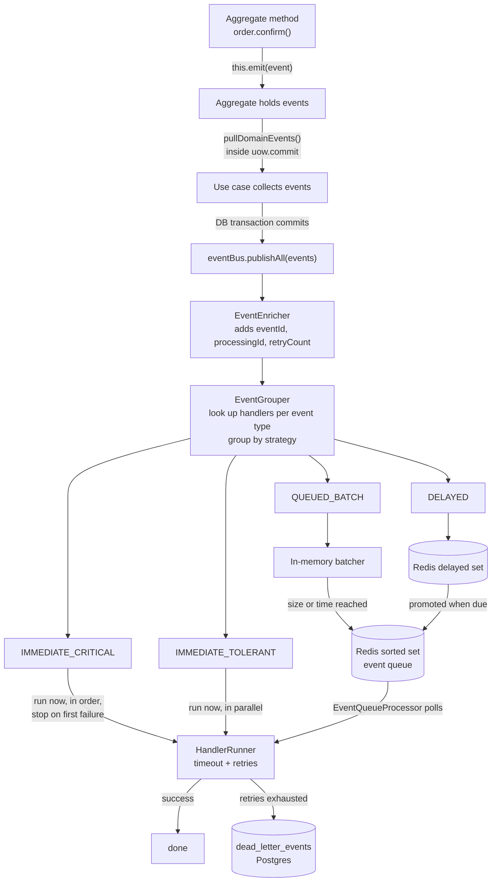

# Event System

The app uses **domain events** to separate "what happened" from "what should happen because of it". When an order is created, the order code does not know that an email will be sent. It only records `ONLINE_ORDER_CREATED`, and registered handlers react.

This page explains how an event travels from an aggregate to a handler, the four execution strategies, retries, the dead-letter queue, and the places where delivery is not guaranteed.

> Related docs: [Architecture overview](./overview.md) · [Request lifecycle](./request-lifecycle.md)

## Concepts

| Term                        | Meaning                                                                           | Where                                                                         |
| --------------------------- | --------------------------------------------------------------------------------- | ----------------------------------------------------------------------------- |
| **Domain event**            | An immutable fact: `aggregateId`, `eventType`, `payload`, `occurredOn`, `version` | `domain/events/*.events.ts`, type enum in `domain/types/domain-event.type.ts` |
| **Aggregate**               | Records events while it changes state (`this.emit(...)`)                          | `domain/common/aggregate-root.ts`                                             |
| **Event bus**               | Port used by use cases to publish events                                          | `EventBusPort` → `EventBusAdapter`                                            |
| **Handler**                 | Reacts to one or more event types, with its own execution options                 | `application/handlers/*.handler.ts`                                           |
| **Strategy**                | _How_ a handler's work is executed: immediately, batched, or delayed              | `infrastructure/events/strategies/`                                           |
| **Dead-letter queue (DLQ)** | Postgres table of handler executions that exhausted their retries                 | `dead_letter_events`                                                          |

## End-to-end flow



The use case never waits for queued or delayed work, but it **does wait** for both immediate strategies.

## Publishing, step by step

1. **Emit.** Inside an aggregate method: `this.emit(new OrderConfirmedEvent(this.id, previousStatus))`.
2. **Collect.** In the use case, `order.pullDomainEvents()` returns the events and clears them from the aggregate. This happens inside the unit-of-work callback, so the events line up with what was written.
3. **Commit, then publish.** After `uow.commit` returns, the use case calls `eventBus.publishAll(events)`.
4. **Enrich.** `EventEnricher` stamps each event with a unique `eventId` and `processingMetadata` (`processingId`, `enqueuedAt`, `retryCount: 0`).
5. **Group.** `EventGrouper` asks the registry which handlers listen to each event type and groups them by strategy. An event with no handlers is skipped (logged at debug level).
6. **Dispatch.** `EventBusAdapter` runs the groups in this order: `IMMEDIATE_CRITICAL`, `IMMEDIATE_TOLERANT`, `QUEUED_BATCH`, `DELAYED`. Strategies that need it are wrapped in a circuit breaker.
7. **Report.** A summary line (`DISPATCH_SUMMARY`) is logged with counts per strategy, including any fallback used.

## The four strategies

Each handler declares a strategy **per event type** it supports, so one handler can treat different events differently.

| Strategy             | Runs                                                                                                                          | Failure behaviour                                                                                                                                           | Use it when                                                                         |
| -------------------- | ----------------------------------------------------------------------------------------------------------------------------- | ----------------------------------------------------------------------------------------------------------------------------------------------------------- | ----------------------------------------------------------------------------------- |
| `IMMEDIATE_CRITICAL` | During `publishAll`, **sequentially** per event, lowest `priority` number first                                               | **Stops at the first failed handler and rethrows.** `publishAll` rejects, and the caller sees the error                                                     | The user must know it failed (for example a password reset email)                   |
| `IMMEDIATE_TOLERANT` | During `publishAll`, **in parallel**                                                                                          | Individual failures are swallowed (they still go to the DLQ after retries). It only throws if at least 10 handler runs were made _and_ more than 10% failed | Side effects that should not break the request (activity logs, confirmation emails) |
| `QUEUED_BATCH`       | Later, in the background. Events collect in memory, flush to Redis when `EVENT_BATCH_SIZE` is reached or the wait time passes | On dispatch failure, falls back to the DLQ                                                                                                                  | Work the user does not need to wait for                                             |
| `DELAYED`            | Later, after `delayMs`. Stored in a Redis sorted set scored by due time                                                       | On failure, falls back to the DLQ                                                                                                                           | Reminders, expirations, timed follow-ups                                            |

Important details:

- **"Immediate" means the HTTP request waits.** A tolerant email handler that takes 3 seconds adds 3 seconds to the response. Choose `QUEUED_BATCH` if latency matters more than immediacy.
- **A critical failure after commit does not roll anything back.** Events are published after the transaction commits, so if a critical handler throws, the database change is already saved while the client receives an error. Design critical handlers to be retry-safe and make clients able to retry the action.
- **A critical failure stops later strategies.** If `IMMEDIATE_CRITICAL` throws, the queued and delayed groups of the _same_ `publishAll` call are not dispatched.
- **`DELAYED` is implemented but currently unused.** No registered handler uses it yet.

### Circuit breaker

The two immediate strategies are wrapped in a circuit breaker (`EventHandlerCircuitBreaker`): it opens after 5 failures within 5 minutes, stays open for 60 seconds, then allows 3 trial calls. While open, dispatch fails fast instead of waiting on handlers that are likely to fail.

## Handlers

A handler is a class extending `BaseEventHandler`. It declares:

```ts
readonly handlerName = "SendEmailHandler";
readonly supportedEvents: Map<DomainEventType, EventHandlerOptions>;
// EventHandlerOptions:
//   priority        lower number runs first (default sort and queue order)
//   strategy        one of the four strategies above
//   retryAttempts   total attempts, default 1 (no retry)
//   timeoutMs       per attempt, default 30000
//   delayMs         only for DELAYED
```

`BaseEventHandler.execute()` wraps `handle()` with start, success and error logging.

### Registered handlers

| Handler                                  | Event                                                | Strategy         | Priority | Attempts | Timeout        |
| ---------------------------------------- | ---------------------------------------------------- | ---------------- | -------- | -------- | -------------- |
| `RecordUserActivityHandler`              | all user, session and password-reset activity events | tolerant         | 5        | 2        | 30 s (default) |
| `RevokeSessionsOnPasswordChangedHandler` | `USER_PASSWORD_CHANGED`                              | tolerant         | 1        | 3        | 15 s           |
| `SendEmailHandler`                       | `USER_ACCOUNT_LOCKED`                                | tolerant         | 1        | 3        | 15 s           |
|                                          | `USER_PASSWORD_CHANGED`                              | tolerant         | 2        | 3        | 15 s           |
|                                          | `USER_EMAIL_VERIFIED`                                | tolerant         | 4        | 3        | 15 s           |
|                                          | `ONLINE_ORDER_CREATED`                               | tolerant         | 1        | 3        | 15 s           |
|                                          | `PASSWORD_RESET_TOKEN_ISSUED`                        | **critical**     | 2        | 5        | 30 s           |
|                                          | `VERIFICATION_EMAIL_TOKEN_ISSUED`                    | **queued batch** | 3        | 5        | 30 s           |
|                                          | `VERIFICATION_EMAIL_TOKEN_REISSUED`                  | **critical**     | 3        | 5        | 30 s           |
|                                          | `GUEST_ORDER_MANAGEMENT_TOKEN_ISSUED`                | **critical**     | 1        | 3        | 15 s           |
|                                          | `GUEST_ORDER_MANAGEMENT_TOKEN_REISSUED`              | **critical**     | 1        | 3        | 15 s           |

Reading the table: a forgotten-password email is critical because the user is waiting on it and must be told if it failed, while the first verification email at registration is queued so signup stays fast.

Handlers are listed in `InMemoryEventHandlerRegistry.buildHandlers()`. A handler that is not listed there never receives events.

## Retries and timeouts (`HandlerRunner`)

Every handler execution, whatever the strategy, goes through `HandlerRunner.run`:

1. Run the handler with a timeout (`timeoutMs`, default 30 s).
2. On failure, wait with exponential backoff (`2^attempt × 100 ms`, so about 200 ms, 400 ms, 800 ms, ...) and try again, up to `retryAttempts`.
3. After the last attempt fails, write the event to the **dead-letter queue** and rethrow.

## The queue (`QUEUED_BATCH` and `DELAYED`)

- **Batcher** (`InMemoryEventBatcher`): holds events in process memory. `BatchFlushCoordinator.flushIfNeeded()` moves them to Redis when the count reaches `EVENT_BATCH_SIZE` (default 20) or the oldest event has waited `EVENT_BATCH_MAX_WAIT_TIME_IN_MS` (default 1000 ms). A mutex prevents two concurrent flushes.
- **Main queue** (`RedisEventQueue`): a Redis sorted set where the score is the handler `priority`. Lower number is dequeued first.
- **Delayed set**: a second sorted set scored by the due timestamp. On each dequeue, due items are promoted into the main queue.
- **Processor** (`EventQueueProcessor`): started in `App.initialize()`. It loops: flush pending batches, dequeue up to `EVENT_QUEUE_PROCESSOR_BATCH_SIZE` (default 20), run them in parallel through `HandlerRunner`, then sleep `EVENT_QUEUE_PROCESSOR_POLL_INTERVAL_IN_MS` (default 5000 ms) before the next round. The next poll is scheduled only after the current batch finishes, so batches never overlap.

The processor runs **inside the API process**. If you run several instances, each one polls the same Redis queue. Dequeue is atomic (`ZPOPMIN`), so an event is taken by only one instance.

## Dead-letter queue

When a handler exhausts its retries, `PrismaDeadLetterQueueAdapter.addFailedEvent` stores a row in `dead_letter_events`:

| Column                                               | Purpose                                                                                                                                                             |
| ---------------------------------------------------- | ------------------------------------------------------------------------------------------------------------------------------------------------------------------- |
| `eventId`, `eventType`, `eventData`                  | Which event and its full payload, so it can be replayed                                                                                                             |
| `handlerName`                                        | Which handler failed (a single event may fail in one handler and succeed in others)                                                                                 |
| `errorMessage`, `errorStack`, `attempts`, `failedAt` | Diagnostics                                                                                                                                                         |
| `canRetry`                                           | `false` for errors that will not succeed on retry (messages containing `invalid email format`, `user already exists`, `permission denied`, or `resource not found`) |
| `retriedAt`                                          | Set when a retry was attempted                                                                                                                                      |

The adapter also provides `retryEvent(id)`, `retryEventsByType(type)`, `deleteEvent(id)`, `cleanupOldEvents(days)` (default 30), and read methods (`getFailedEvents`, `getFailedEventsByType`, `getFailedEventsCount`). A retry runs only that handler through `RetryHandlerInvoker`, not every handler of the event.

## Delivery guarantees and known gaps

Be aware of these when you design a feature that depends on events:

| Situation                                                       | What happens                                                                                                                                                                       |
| --------------------------------------------------------------- | ---------------------------------------------------------------------------------------------------------------------------------------------------------------------------------- |
| Process crashes between DB commit and `publishAll`              | Events are lost. There is no transactional outbox                                                                                                                                  |
| Process crashes while events sit in the in-memory batcher       | Those queued events are lost (they were never written to Redis)                                                                                                                    |
| Process crashes after `ZPOPMIN` but before the handler finishes | The event is gone from Redis and not in the DLQ                                                                                                                                    |
| A handler fails in `IMMEDIATE_CRITICAL`                         | Request returns an error although the data was saved                                                                                                                               |
| Handler runs twice (a DLQ retry, or an at-least-once replay)    | Handlers should be **idempotent**. Nothing deduplicates them                                                                                                                       |
| DLQ rows                                                        | Nothing in the codebase calls the retry or cleanup methods yet, and there are no HTTP routes for them. Failed events accumulate until you add an admin endpoint or a scheduled job |
| `EventBusAdapter.cleanupStaleHandlers`                          | Stub with a TODO; it currently does nothing                                                                                                                                        |
| Redis down                                                      | `QUEUED_BATCH` and `DELAYED` fall back to the DLQ. Immediate strategies are unaffected because they do not use Redis                                                               |

For emails these gaps are acceptable, because the guest-order and password-reset flows have "resend" endpoints. For anything money-related, prefer an immediate strategy and idempotent handlers, or add an outbox.

## Observability

Searchable `event` values in the logs:

- `DISPATCH_SUMMARY`: one line per `publishAll`, with per-strategy results
- `HANDLER_RETRY`, `CRITICAL_HANDLER_FAILED`
- `FALLBACK_TO_DLQ`, `DLQ_FALLBACK_FAILED`, `CIRCUIT_BREAKER_FALLBACK_SUCCESS`
- `BATCH_PARTIAL_FAILURE`, `PROCESSING_BATCH`, `HANDLER_NOT_FOUND` (queued event whose handler is no longer registered)
- `NO_HANDLERS_REGISTERED` (debug): an event type nobody listens to

To see what is failing in production, query the table:

```sql
SELECT event_type, handler_name, count(*), max(failed_at)
FROM dead_letter_events
WHERE can_retry = true
GROUP BY 1, 2
ORDER BY 3 DESC;
```

## Configuration

| Variable                                                                                       | Default         | Controls                                         |
| ---------------------------------------------------------------------------------------------- | --------------- | ------------------------------------------------ |
| `EVENT_BATCH_SIZE`                                                                             | 20              | Flush the batcher at this many events            |
| `EVENT_BATCH_MAX_WAIT_TIME_IN_MS`                                                              | 1000            | ...or when the oldest event has waited this long |
| `EVENT_BATCH_FLUSH_INTERVAL_IN_MS`, `EVENT_BATCH_MAX_RETRIES`, `EVENT_BATCH_RETRY_DELAY_IN_MS` | 1000 / 3 / 1000 | Batcher tuning                                   |
| `EVENT_QUEUE_MAX_RETRIES`                                                                      | 3               | Redis queue operation retries                    |
| `EVENT_QUEUE_HEALTH_CHECK_INTERVAL`, `EVENT_QUEUE_BATCH_TIMEOUT`                               |                 | Queue health and timeout                         |
| `EVENT_QUEUE_PROCESSOR_BATCH_SIZE`                                                             | 20              | Events handled per poll                          |
| `EVENT_QUEUE_PROCESSOR_POLL_INTERVAL_IN_MS`                                                    | 5000            | Delay between polls                              |

Per-handler retries, timeouts and priorities are set in code, in each handler's `supportedEvents`.
