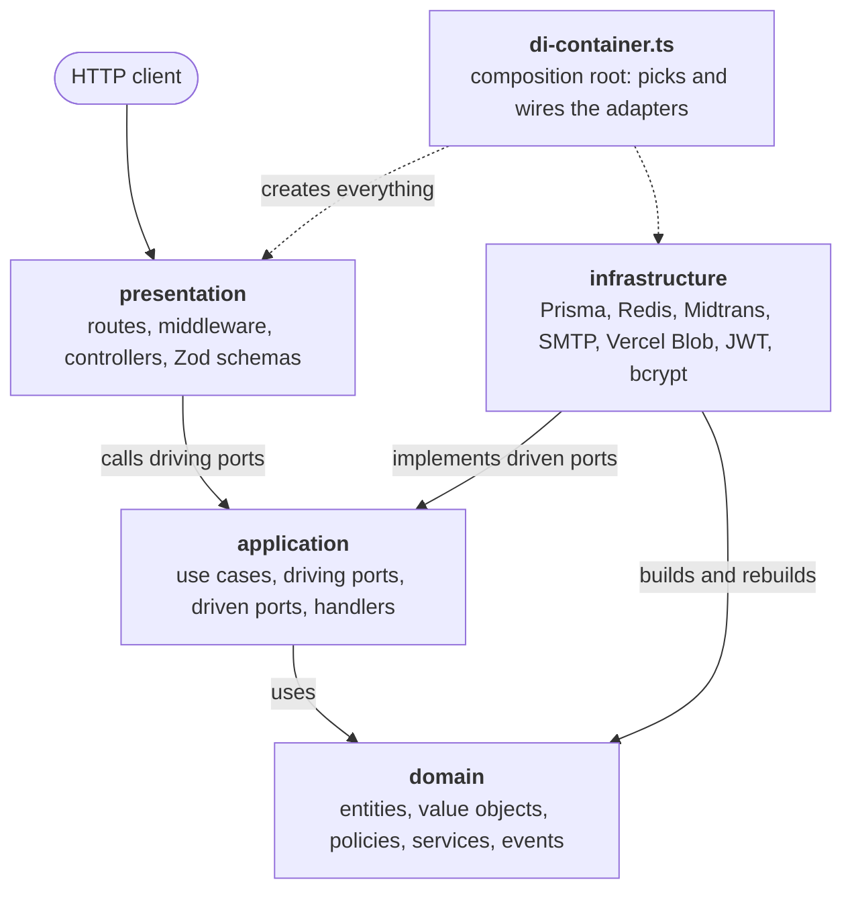

# Architecture Overview

Express F&B is structured as a **hexagonal architecture** (also called _ports and adapters_) with domain-driven design building blocks. The goal is simple: business rules must not depend on Express, Prisma, Redis, or any other technology, so each of those can be changed or faked without touching the rules.

> Related docs: [Request lifecycle](./request-lifecycle.md) · [Event system](./events.md)

## The four layers



Read every solid arrow as **"depends on"**. Nothing points out of `domain`, and nothing in `application` points at `infrastructure` or `presentation`: the application only declares what it needs (driven ports) and infrastructure fulfils it.

| Layer              | Folder               | Responsibility                                                                                                                              | May depend on                                                      |
| ------------------ | -------------------- | ------------------------------------------------------------------------------------------------------------------------------------------- | ------------------------------------------------------------------ |
| **Domain**         | `src/domain`         | Entities, value objects, policies, domain services, domain events and exceptions. Pure TypeScript, no I/O.                                  | nothing else in the project                                        |
| **Application**    | `src/application`    | Use cases that orchestrate the domain, plus the port interfaces they need. Event handlers, factories, mappers.                              | domain                                                             |
| **Infrastructure** | `src/infrastructure` | Adapters that implement driven ports: Prisma, Redis, Midtrans, Nodemailer, Vercel Blob, JWT, bcrypt, the event bus. Also env-based configs. | application, domain                                                |
| **Presentation**   | `src/presentation`   | Routes, controllers, middleware, Zod request schemas, HTTP error mapping, rate-limit policies.                                              | application, domain (plus a few infrastructure helpers, see below) |

**The dependency rule:** source code dependencies point inward. `domain` and `application` import nothing from `infrastructure` or `presentation`. This is what lets you swap Midtrans for another gateway by writing a new adapter, without editing a single use case.

`src/di-container.ts` is the **composition root**. It is the one place allowed to know about everything, because it is where concrete adapters are chosen and connected.

> **Pragmatic exceptions.** `presentation` imports a handful of things from `infrastructure` directly: the rate-limit middleware (`ApiRateLimit`), the health controller (Prisma and Redis clients), the request-context middleware (`NodeAsyncLocalStorage`), and exception base classes used by the error mapper. These are cross-cutting concerns, not business logic.

## Ports and adapters

A **port** is an interface owned by the application layer. An **adapter** is a class in infrastructure that implements it.

There are two kinds of ports:

| Kind                   | Folder                      | Direction                       | Example                                                        |
| ---------------------- | --------------------------- | ------------------------------- | -------------------------------------------------------------- |
| **Driving** (primary)  | `application/ports/driving` | The outside world calls the app | `CreateOnlineOrderUseCasePort`                                 |
| **Driven** (secondary) | `application/ports/driven`  | The app calls the outside world | `PaymentGatewayPort`, `OrderRepositoryPort`, `EmailSenderPort` |

### Worked example: payments

```
presentation/controllers/payment.controller.ts
        │ depends on
        ▼
application/ports/driving/initiate-charge.use-case.port.ts     (driving port)
        ▲ implemented by
application/use-cases/payment/initiate-charge.use-case.ts
        │ depends on
        ▼
application/ports/driven/payment-gateway.port.ts                (driven port)
        ▲ implemented by
infrastructure/payment/midtrans-payment-gateway.adapter.ts      (adapter)
```

The controller knows only the use case contract. The use case knows only `PaymentGatewayPort`. Midtrans appears in exactly one class, wired in `di-container.ts`.

### Driven ports in this project

| Concern              | Port                                                                   | Adapter                                                               |
| -------------------- | ---------------------------------------------------------------------- | --------------------------------------------------------------------- |
| Persistence          | `*.repository.port.ts` (user, session, order, product, ...)            | `infrastructure/database/repositories/prisma-*.repository.adapter.ts` |
| Transactions         | `UnitOfWorkPort`                                                       | `PrismaUnitOfWorkAdapter`                                             |
| Events               | `EventBusPort`                                                         | `EventBusAdapter`                                                     |
| Payments             | `PaymentGatewayPort`                                                   | `MidtransPaymentGatewayAdapter`                                       |
| Email                | `EmailSenderPort`                                                      | `NodemailerEmailSenderAdapter`                                        |
| Image storage        | `ObjectStoragePort`                                                    | `VercelBlobObjectStorageAdapter`                                      |
| Passwords            | `PasswordHasherPort`                                                   | `BcryptPasswordHasherAdapter`                                         |
| Tokens               | `AuthTokenIssuerPort`, `AuthTokenVerifierPort`, `AuthTokenDecoderPort` | `JWTAuthToken*Adapter`                                                |
| Token hashing        | `FingerprintPort`                                                      | `Sha256FingerprintAdapter`                                            |
| Secure random tokens | `TokenGeneratorPort`                                                   | `CryptoTokenGeneratorAdapter`                                         |
| IDs                  | `IdGeneratorPort`                                                      | `IdGeneratorAdapter`                                                  |
| Distance             | `DistanceCalculatorPort`                                               | `HaversineDistanceCalculatorAdapter`                                  |
| Logging              | `LoggerPort`                                                           | `WinstonLogger`                                                       |
| Request context      | `RequestContextPort`                                                   | `NodeRequestContextAdapter` (AsyncLocalStorage)                       |

## Domain layer building blocks

- **Entities / aggregate roots** (`domain/entities`): `Order`, `Product`, `User`, `Session`, `PaymentTransaction`, `ApplicationToken`, `ProductCategory`. They extend `AggregateRoot`, enforce their own invariants (for example order status transitions), and are created through static factory methods such as `Order.createOnlineOrder(...)`. `Entity.rebuild(...)` re-hydrates one from stored data without emitting events.
- **Value objects** (`domain/value-objects`): immutable, self-validating types like `Money`, `Coordinate`, `UserEmail`, `Expiration`, `OrderItem`, `OrderPricing`.
- **Policies** (`domain/policies`): plain interfaces describing business rules that are configurable, such as `PricingPolicy` (tax and service charge), `DeliveryFeePolicy`, `LoginSecurityPolicy`, `SessionPolicy`. The domain only defines the _shape_.
- **Domain services** (`domain/services`): stateless rule logic that does not belong to one entity, such as `DeliveryFeeCalculatorService`, `OrderQuantityValidatorService`, and the `*AccessControlService` classes.
- **Domain events** (`domain/events`): facts about what happened (`OrderConfirmedEvent`, `OrderPaidEvent`, ...). Aggregates record them with `emit()`, and use cases collect them with `pullDomainEvents()`. See [Event system](./events.md).
- **Domain exceptions** (`domain/exceptions`): business rule violations such as `InvalidOrderStatusTransitionException`.

### Policies are domain interfaces, configs are infrastructure

Business parameters come from environment variables, but the domain must not read `process.env`. So the split is:

```
domain/policies/pricing.policy.ts                       interface PricingPolicy { taxRatePercent, ... }
infrastructure/configs/pricing-policy.config.ts         class PricingPolicyEnvConfig implements PricingPolicy
                                                        (reads TAX_RATE_PERCENT, SERVICE_CHARGE_RATE_PERCENT)
```

Use cases receive the `PricingPolicy` interface and never know where the numbers came from. In tests you can pass a plain object.

## Application layer building blocks

- **Use cases** (`application/use-cases/<area>/`): one class per operation, implementing a driving port. They load aggregates through repositories, call domain methods, persist inside a unit of work, then publish domain events.
- **Commands, queries and results** are declared next to the driving port (see `create-online-order.use-case.port.ts`), so the contract is visible in one file.
- **Factories** (`application/factories`): `SessionFactory` and `ApplicationTokenFactory` build entities that need several collaborators (token issuing, fingerprinting, ID generation).
- **Mappers** (`application/mappers`): convert entities to response DTOs so controllers never expose domain objects directly.
- **Event handlers** (`application/handlers`): react to domain events (send an email, record user activity, revoke sessions). They are registered in the event system.
- **Application exceptions** (`application/exceptions`): failures at the use case level, such as `UnauthenticatedException`.

### Transactions: the Unit of Work

Use cases that write data run inside `uow.commit(...)`:

```ts
const result = await this.uow.commit(async (repos) => {
  const products = await repos.productRepository.findByIds(ids);
  const order = Order.createOnlineOrder({ ... });
  await repos.orderRepository.insert(order);
  return { order, events: order.pullDomainEvents() };
});

await this.eventBus.publishAll(result.events);   // after commit
```

`PrismaUnitOfWorkAdapter` opens one database transaction and hands the use case a set of repositories bound to it (`repository.withTransaction(tx)`). Everything inside the callback commits or rolls back together. Read-only use cases skip the unit of work and use the repository directly.

> **Note on event delivery.** Events are published _after_ the transaction commits, not stored in the same transaction (there is no transactional outbox). If the process dies between commit and publish, those events are lost. See [Event system](./events.md#delivery-guarantees-and-known-gaps).

## Infrastructure layer building blocks

| Folder             | Contents                                                                                                     |
| ------------------ | ------------------------------------------------------------------------------------------------------------ |
| `database/`        | `PrismaDatabaseClient` (with a circuit breaker), the Unit of Work, repository adapters, transaction context  |
| `cache/`           | `RedisConnectionManager`                                                                                     |
| `events/`          | Event bus, strategies, queue, batcher, retry, dead-letter queue (see [Event system](./events.md))            |
| `rate-limit/`      | `RedisApiRateLimit`, policy and exception types                                                              |
| `circuit-breaker/` | Generic `CircuitBreaker` and its factory, used by the DB client, rate limiter and event bus                  |
| `security/`        | JWT issuer/verifier/decoder, bcrypt hasher, SHA-256 fingerprint, secure token generator                      |
| `email/`           | Nodemailer client and sender, HTML templates, template factory                                               |
| `payment/`         | Midtrans gateway adapter                                                                                     |
| `object-storage/`  | Vercel Blob adapter                                                                                          |
| `geolocation/`     | Haversine distance calculator                                                                                |
| `request-context/` | AsyncLocalStorage-based request context                                                                      |
| `logger/`          | Winston adapter                                                                                              |
| `configs/`         | One `*EnvConfig` class per concern, built on a small `env-reader` helper that validates variables at startup |

## Dependency injection

There is no DI framework. `DIContainer` in `src/di-container.ts` is a hand-written singleton: its constructor creates every config, adapter, use case, and controller in dependency order, and exposes them as `public readonly` fields. Routes and `app.ts` obtain it with `getDIContainer()`.

Things to know:

- **Order matters.** A dependency must be created before the object that needs it. Add new objects below their dependencies.
- **Circular dependencies** are broken with a lazy getter. For example, `RetryHandlerInvoker` receives `() => this.handlerRunner` because the dead-letter queue and the runner depend on each other.
- **It fails fast.** Env configs are constructed (and validated) as soon as the container is first created, so a missing variable stops the app at boot rather than on the first request.
- **Tests can bypass it.** Because use cases take ports in their constructors, you can instantiate one directly with fakes and never touch the container.

## Cross-cutting concerns

| Concern                         | Where                                | How                                                                                               |
| ------------------------------- | ------------------------------------ | ------------------------------------------------------------------------------------------------- |
| Request ID, user ID, IP, device | `request-context.middleware.ts`      | Stored in `AsyncLocalStorage`; the logger and error filter read it without it being passed around |
| Logging                         | `LoggerPort` / `WinstonLogger`       | Structured logs with `context` and `event` fields; automatically enriched with request context    |
| Error handling                  | `HTTPErrorFilter`, `ExceptionMapper` | See [Request lifecycle](./request-lifecycle.md#error-handling)                                    |
| Rate limiting                   | `rateLimitMiddleware` + Redis        | Per-route policies, separate limits for anonymous and authenticated callers                       |
| Resilience                      | `CircuitBreaker`                     | Wraps the database client, rate limiter, and event dispatch                                       |
| Validation                      | `ZodRequestValidation`               | Called in controllers; throws `RequestValidationException`                                        |

## Where do I put this?

| If it is...                                           | It belongs in                                                     |
| ----------------------------------------------------- | ----------------------------------------------------------------- |
| A rule about how orders, prices, or sessions behave   | `domain` (entity method, value object, policy, or domain service) |
| A step-by-step flow for one user action               | `application/use-cases`                                           |
| An interface for something external                   | `application/ports/driven`                                        |
| Code that talks to a database, API, or library        | `infrastructure`                                                  |
| Parsing the HTTP request or shaping the HTTP response | `presentation`                                                    |
| Reading an environment variable                       | `infrastructure/configs`                                          |

When unsure, ask: _"Would this need to change if we replaced Express/Prisma/Redis?"_ If yes, it is not domain or application code.
