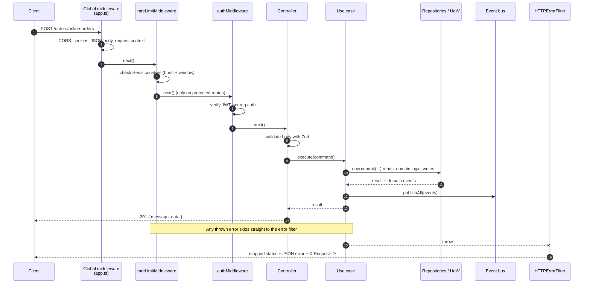
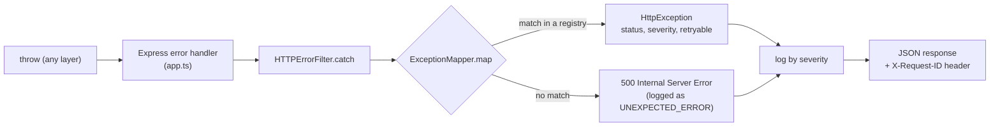

# Request Lifecycle

This page follows a single HTTP request from the socket to the response, and explains how errors travel back out. It uses `POST /orders/online-orders` as the running example because it touches every layer.

> Related docs: [Architecture overview](./overview.md) · [Event system](./events.md)

## The pipeline at a glance



## Step by step

### 1. Global middleware (`src/app.ts`)

Applied in this order to every request:

| #   | Middleware                            | What it does                                                                               |
| --- | ------------------------------------- | ------------------------------------------------------------------------------------------ |
| 1   | `trust proxy`                         | Express trusts proxy headers so `req.ip` is the real client IP                             |
| 2   | `cors`                                | Allows only `CLIENT_URL` as origin, with credentials (needed for the refresh-token cookie) |
| 3   | `cookieParser`                        | Makes `req.cookies` available (the `refresh_token` cookie)                                 |
| 4   | `express.json` (10 MB) / `urlencoded` | Body parsing. Multipart uploads are handled later, per route, by `multer`                  |
| 5   | `requestContextMiddleware`            | Opens an `AsyncLocalStorage` scope for the request (see below)                             |

After the routes: a catch-all that returns `404 { success: false, message: "Route ... not found" }`, then the error handler.

### 2. Request context

`requestContextMiddleware` runs the rest of the request inside an `AsyncLocalStorage` store containing:

| Field       | Source                                      |
| ----------- | ------------------------------------------- |
| `requestId` | Newly generated ID                          |
| `ipAddress` | `req.ip`                                    |
| `userAgent` | `User-Agent` header                         |
| `deviceId`  | `X-Device-ID` header                        |
| `userId`    | `sub` claim of the Bearer token, if present |

Any code, at any depth, can read this through `RequestContextPort.get()` without it being passed as an argument. The logger attaches it to log lines, the error filter returns the `requestId`, sessions record IP and device, and the rate limiter uses it to identify the caller.

> **Important:** `userId` here comes from `jwt.decode`, which **does not verify the signature**. It is a hint for logging and rate limiting, never proof of identity. Real authentication happens in `authMiddleware` (step 4) and in controllers that call `authTokenVerifier.verifyAccessToken`. Do not use `requestContext.userId` for authorization decisions.

### 3. Rate limiting (`rateLimitMiddleware`)

Each route declares a policy from `presentation/rate-limit/policies/*.policy.ts`:

```ts
CREATE_ONLINE_ORDER: {
  authenticated: { maxAttempts: 5, burst: 10 },
  anonymous:     { maxAttempts: 3, burst: 5 },
  windowSeconds: 300,
}
```

How it is enforced (`RedisApiRateLimit`):

- **Key:** `rate_limit:<METHOD>:<baseUrl+path>:<identifier>`, where the identifier is the user ID if a token is present, otherwise the IP address.
- **Two counters per request:** a _window_ counter (`maxAttempts` per `windowSeconds`) and, if `burst` is set, a _burst_ counter (`burst` per 60 seconds). Both must pass.
- **Atomic:** counting runs in a single Redis Lua script.
- **Tiers:** `anonymous` and `authenticated` have separate limits. `maxAttempts: 0` blocks a tier entirely (for example anonymous dine-in orders).
- **Exceeding a limit** throws a rate limit exception, mapped to **HTTP 429**.

Because the path is part of the key, `GET /orders/:id` is counted per concrete path (for example `/orders/abc`), not per route pattern.

**When Redis is unhealthy**, a dedicated circuit breaker protects the API from slow Redis calls. Behaviour is configured with env variables:

| Variable                           | Values                        | Effect                                                                                              |
| ---------------------------------- | ----------------------------- | --------------------------------------------------------------------------------------------------- |
| `RATE_LIMIT_ERROR_STRATEGY`        | `allow` / `deny`              | What to do when a rate-limit check fails unexpectedly                                               |
| `RATE_LIMIT_CIRCUIT_OPEN_STRATEGY` | `allow` / `deny` / `throttle` | What to do while the breaker is open. `throttle` applies a small in-memory limiter per caller       |
| `RATE_LIMIT_COOLDOWN_PERIOD_IN_MS` | number                        | How long the breaker stays open                                                                     |
| `RATE_LIMIT_SECURITY_ALERTS`       | `true` / `false`              | Emit a security alert hook on unexpected failures (the notification itself is still a TODO in code) |

### 4. Authentication (`authMiddleware`, protected routes only)

```ts
const accessToken = AuthTokenUtil.getAccessToken(req); // "Authorization: Bearer <jwt>"
if (!accessToken) throw new UnauthenticatedException();
req.auth = authTokenVerifier.verifyAccessToken(accessToken); // verifies signature and expiry
```

`req.auth` is typed as `AuthenticatedRequest["auth"]` and carries `sub`, `email`, `name`, and `role`. The middleware only proves _who_ the caller is. Whether they may perform the action (role checks, ownership) is decided later by domain access-control services inside the use case.

Routes are of three kinds:

| Kind              | Example                                         | Behaviour                                                                                                                                                                              |
| ----------------- | ----------------------------------------------- | -------------------------------------------------------------------------------------------------------------------------------------------------------------------------------------- |
| **Public**        | `GET /products/browse`                          | No auth middleware                                                                                                                                                                     |
| **Protected**     | `POST /products`, `GET /orders/browse`          | `authMiddleware` rejects with 401 if no valid token                                                                                                                                    |
| **Optional auth** | `POST /orders/online-orders`, `GET /orders/:id` | No middleware; the controller reads a token if present (`getMemberId`) and otherwise treats the caller as a guest. Guests prove access to an order with a `guestToken` query parameter |

Only the protected kind runs `authMiddleware`. Optional-auth controllers call `authTokenVerifier.verifyAccessToken` themselves when a Bearer token is sent, so an invalid or expired token on those routes results in an authentication error rather than being silently treated as a guest.

### 5. Route-specific middleware

- `uploadImage` (`multer`) on product image routes parses `multipart/form-data` into `req.files` or `req.file`.

### 6. Controller

Controllers are thin. Each method does three things: build an input object, validate it, call a use case, and shape the response.

```ts
async createOnlineOrder(req: Request, res: Response) {
  const payload = { ...req.body, memberId: this.getMemberId(req) };
  const dto = this.validation.validate<CreateOnlineOrderSchemaType>(CreateOnlineOrderSchema, payload);
  const result = await this.createOnlineOrderUseCase.execute(dto);
  return res.status(201).json({ message: "Order created successfully", data: result });
}
```

- **Validation** uses a Zod schema from `presentation/validation/schemas/`. On failure `ZodRequestValidation` throws `RequestValidationException` containing every issue (`field`, `message`, `code`).
- Controllers depend on **driving ports only** (`CreateOnlineOrderUseCasePort`), never on concrete use cases or repositories.
- Controllers contain no business rules. If you find an `if` about prices or statuses in a controller, it belongs in the domain.
- Controller methods are `async` and do not catch errors. Express 5 forwards rejected promises to the error handler automatically.

### 7. Use case

The use case is where the flow lives. For `CreateOnlineOrderUseCase`:

1. Assert minimum quantity (`OrderQuantityValidatorService`).
2. Calculate the delivery fee: Haversine distance from the store to the destination, then `DeliveryFeeCalculatorService` with the `DeliveryFeePolicy`.
3. Inside `uow.commit(...)`: load products, build the `Order` aggregate (`Order.createOnlineOrder`), optionally issue a guest management token, insert both, collect domain events.
4. After commit, `eventBus.publishAll(events)` triggers side effects such as the confirmation email.
5. Return `{ id }`.

See [Architecture overview](./overview.md#transactions-the-unit-of-work) for how the unit of work works.

### 8. Response

Successful responses are built in the controller and use the shape `{ message, data? }` with an appropriate status code (`200`, `201`). Authentication routes also set or clear the `refresh_token` cookie (`httpOnly`, `sameSite: lax`, `secure` in production, lifetime from `REFRESH_TOKEN_LIFETIME_DAYS`).

## Error handling

Errors are **thrown, not returned**. Any layer can throw a typed exception, and a single place converts it to HTTP.



### Exception families

Each layer owns its own exception base class, so the mapper knows where an error came from:

| Family             | Base class                    | Examples                                                            | Registry                                   |
| ------------------ | ----------------------------- | ------------------------------------------------------------------- | ------------------------------------------ |
| Rate limit         | `BaseApiRateLimitException`   | `RequestLimitExceededException`, `BurstLimitExceededException`      | `api-rate-limit-exception.registry.ts`     |
| Request validation | `RequestValidationException`  | Zod failures                                                        | `request-validation.exception.registry.ts` |
| Application        | `BaseApplicationException`    | `UnauthenticatedException`                                          | `application-exception.registry.ts`        |
| Domain             | `BaseDomainException`         | `InvalidOrderStatusTransitionException`, `ForbiddenActionException` | `domain-exception.registry.ts`             |
| Infrastructure     | `BaseInfrastructureException` | Database, Redis, gateway failures                                   | `infrastructure-exception.registry.ts`     |

The mapper checks them in the order shown above. Domain and application code never mention HTTP status codes. The mapping lives only in `presentation/exceptions/registries/`:

```ts
// registry entry
[RequestLimitExceededException, { statusCode: 429, severity: Severity.LOW, retryable: false }],
```

### What the client receives

```json
{
  "requestId": "…",
  "code": "HTTP_429",
  "message": "…",
  "details": {},
  "timestamp": "2026-10-27T06:00:00.000Z",
  "retryable": false
}
```

The same `requestId` is returned in the `X-Request-ID` response header and written to the server logs, so a user-reported ID can be traced to the exact log lines.

### Severity and logging

The filter logs every handled exception, at a level based on the mapping's `severity`:

| Severity           | Log level |
| ------------------ | --------- |
| `CRITICAL`, `HIGH` | `error`   |
| `MEDIUM`           | `warn`    |
| `LOW`              | `debug`   |

An exception that is **not in any registry** is treated as a bug: it is logged at `error` with its stack trace as `UNEXPECTED_ERROR`, and the client gets a generic `500 Internal Server Error` with no internal details.

### Rule: a new exception needs a registry entry

If you add an exception class and forget to register it, it silently becomes a `500`. After adding one, add it to the matching registry with the status code you want. See [Adding a feature](./adding-a-feature.md).
