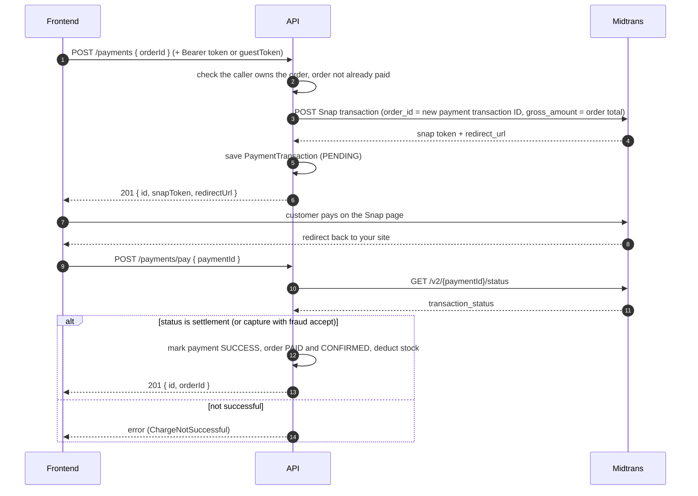

# Third-Party Integrations

Express F&B depends on five external services and one client (your frontend). This page explains how to set each one up, how the app uses it, and the traps to avoid.

> Not about integration _tests_: this is about connecting real services. Related: [Environment variables](./environment.md) · [Architecture overview](../architecture/overview.md#ports-and-adapters)

| Service                                   | Used for                    | Required variables                           | Fails how                                                 |
| ----------------------------------------- | --------------------------- | -------------------------------------------- | --------------------------------------------------------- |
| [PostgreSQL](#postgresql)                 | All persistent data         | `DATABASE_URL`                               | App cannot do anything useful; `/health` returns 503      |
| [Redis](#redis)                           | Rate limiting, event queue  | `REDIS_HOST` (+ optional port/auth/TLS)      | Degrades: see below; `/health` returns 503                |
| [Midtrans](#midtrans-payments)            | Taking payments             | `MIDTRANS_SERVER_KEY`, two URLs              | Charge fails with an "external service unavailable" error |
| [SMTP](#email-smtp)                       | Transactional email         | `EMAIL_USER`, `EMAIL_PASSWORD` (+ host/port) | Depends on the email, see [Email catalog](#email-catalog) |
| [Vercel Blob](#image-storage-vercel-blob) | Product and category images | `VERCEL_BLOB_READ_WRITE_TOKEN`               | Image upload and delete fail                              |
| [Your frontend](#frontend-contract)       | Customer and staff UI       | `CLIENT_URL`                                 | CORS errors, broken email links, no refresh cookie        |

Every integration sits behind a **port** (an interface), so you can replace one without touching business code.

---

## PostgreSQL

**Role:** the system of record. Accessed through Prisma 7 with the `@prisma/adapter-pg` driver adapter.

### Local setup

Install PostgreSQL for your operating system and create an empty database. Then point the app at it:

```dotenv
DATABASE_URL="postgresql://postgres:<your-password>@localhost:5432/fnb"
```

Create the tables and the Prisma client:

```bash
npx prisma generate        # creates the client in prisma/generated (git-ignored)
npx prisma migrate dev     # applies prisma/migrations and keeps your dev DB in sync
```

### Notes

- `prisma.config.ts` reads `DATABASE_URL` for migrations. The running app reads the same variable.
- Hosted providers usually require TLS. Append the provider's required parameter, typically `?sslmode=require`.
- URL-encode special characters in the password (`@` becomes `%40`).
- Changing `prisma/schema.prisma`? Run `npx prisma migrate dev --name what_changed` and commit the new folder under `prisma/migrations/`.
- The database client is wrapped in a circuit breaker, so a failing database trips fast instead of stacking up requests.

---

## Redis

**Role:** two jobs. (1) **Rate limiting**: counters per caller and route. (2) **Event queue**: the `QUEUED_BATCH` and `DELAYED` event strategies store pending work in Redis sorted sets. See [Event system](../architecture/events.md#the-queue-queued_batch-and-delayed).

### Local setup

Redis has no official Windows build, so on Windows run it inside WSL (Ubuntu): `sudo apt install redis-server`, then `sudo service redis-server start`. On Linux or macOS, install it with your package manager.

```dotenv
REDIS_HOST="localhost"
REDIS_PORT=6379
```

For managed Redis (Upstash, Redis Cloud, ElastiCache, ...) set `REDIS_TLS=true` and provide `REDIS_PASSWORD` (and `REDIS_USERNAME` if the provider uses ACL users).

### What happens when Redis is down

| Feature                           | Behaviour                                                                                                                                                              |
| --------------------------------- | ---------------------------------------------------------------------------------------------------------------------------------------------------------------------- |
| Rate limiting                     | A circuit breaker opens. Depending on `RATE_LIMIT_CIRCUIT_OPEN_STRATEGY`, requests are allowed, denied, or throttled by a small in-memory limiter (default `throttle`) |
| `QUEUED_BATCH` / `DELAYED` events | Dispatch fails and the events fall back to the dead-letter table in Postgres                                                                                           |
| Immediate event strategies        | Not affected                                                                                                                                                           |
| `/health`                         | Returns `503`                                                                                                                                                          |
| Startup                           | The app still boots. The Redis client logs `CONNECTION_ERROR` and keeps reconnecting, and the event queue processor logs errors until Redis returns                    |

Commands fail immediately when Redis is unreachable (the client has its offline queue disabled on purpose).

---

## Midtrans (payments)

**Role:** hosted checkout. The app asks Midtrans Snap for a payment page, the customer pays there, and the app then confirms the result with Midtrans before marking the order paid.

### Setup

1. Create a Midtrans account and open the **Sandbox** environment.
2. In the dashboard, copy the sandbox **Server Key** (Settings, Access Keys).
3. Set the variables:

   ```dotenv
   MIDTRANS_SERVER_KEY="<sandbox server key>"
   MIDTRANS_SNAP_BASE_URL="https://app.sandbox.midtrans.com/snap/v1/transactions"
   MIDTRANS_CORE_API_BASE_URL="https://api.sandbox.midtrans.com/v2"
   ```

> **Check this URL.** The adapter POSTs to `MIDTRANS_SNAP_BASE_URL` exactly as written and does not append anything. Midtrans documents the Snap endpoint as `.../snap/v1/transactions`. `.env.example` currently shows `.../snap/v1` without `/transactions`, which would not hit the transaction endpoint. Use the full URL above, and consider fixing `.env.example`.

### The payment flow



Things to know about this flow:

- **The `order_id` sent to Midtrans is the app's payment transaction ID** (a UUID), not the order ID. Use that ID when looking a payment up in the Midtrans dashboard.
- **Amounts are whole rupiah.** `gross_amount` is the order total.
- **Each `POST /payments` creates a new payment transaction** and a new Snap token. A customer who abandons one attempt and retries gets a fresh one. Once an order is paid, further attempts are rejected.
- **The Midtrans call happens before the database insert.** If the insert fails after Midtrans accepted the request, an unused Snap transaction is left behind at Midtrans. It is harmless (it expires unpaid) but may show up in the dashboard.
- **Stock is deducted at payment time**, not when the order is created.
- **`POST /payments/pay` is safe from spoofing**: it ignores any claim from the client and asks Midtrans for the real status server-to-server. It is idempotent (calling it again for an already-paid transaction returns the same result). It is, however, unauthenticated and has no rate limit.

### Known gap: no webhook yet

Today, payment confirmation depends on **the customer's browser coming back** and calling `POST /payments/pay`. If they pay and then close the tab, Midtrans has the money but the order stays unconfirmed. The code marks this with TODOs (`// TODO: handled by webhook`).

The building blocks for a webhook already exist:

| Piece              | Where                                                  | State                                                                                               |
| ------------------ | ------------------------------------------------------ | --------------------------------------------------------------------------------------------------- |
| Signature check    | `MidtransPaymentGatewayAdapter.verifyWebhookSignature` | Implemented (SHA-512 of `order_id + status_code + gross_amount + server key`), but **never called** |
| Confirmation logic | `HandlePaymentUseCase`                                 | Works, and is idempotent                                                                            |
| Receiving route    | none                                                   | Missing                                                                                             |

To finish it:

1. Add a route such as `POST /payments/webhooks/midtrans` with a Zod schema for the notification body.
2. Verify `signature_key` with `verifyWebhookSignature`. Reject with 401/403 if it does not match.
3. Call `HandlePaymentUseCase` with `paymentId = order_id`.
4. Respond `200` quickly. Midtrans retries non-2xx responses.
5. In the Midtrans dashboard set the **Payment Notification URL** (Settings, Configuration) to that route's public URL. It must be reachable from the internet, so use a tunnel for local testing.
6. Handle failed, expired and cancelled notifications too. `HandlePaymentUseCase` currently handles only success.
7. Keep `POST /payments/pay`, or remove it once the frontend no longer needs it.

### How statuses map

| Midtrans `transaction_status`          | App result                                               |
| -------------------------------------- | -------------------------------------------------------- |
| `settlement`                           | SUCCESS                                                  |
| `capture` with `fraud_status = accept` | SUCCESS                                                  |
| `capture` with any other fraud status  | PENDING                                                  |
| `pending`                              | PENDING                                                  |
| `deny`, `cancel`, `expire`, `failure`  | FAILED                                                   |
| anything else                          | Error (logged as "Unmapped Midtrans transaction_status") |

| Midtrans `payment_type`                                       | App `PaymentMethod` |
| ------------------------------------------------------------- | ------------------- |
| `gopay`, `shopeepay`, `dana`, `ovo`, `linkaja`                | `E_WALLET`          |
| `qris`                                                        | `QRIS`              |
| `bank_transfer`, `echannel`, `permata_va`, `bca_va`, `bni_va` | `BANK_TRANSFER`     |
| `credit_card`                                                 | `CARD`              |
| `cstore`                                                      | `CASH`              |
| `akulaku`, `kredivo`                                          | `OTHER`             |

### Switching to production

1. Complete Midtrans' production activation and get the **production** Server Key.
2. Change **all three** values: the key and both URLs (`https://app.midtrans.com/snap/v1/transactions` and `https://api.midtrans.com/v2`).
3. Set the Payment Notification URL in the production dashboard.

> `MIDTRANS_IS_PRODUCTION` is read into the config but **nothing in the code uses it**. Setting it to `true` does not switch environments. Only the key and URLs do. Mixing a production key with sandbox URLs (or the reverse) fails with authorization errors.

### Other notes

- **Refunds:** `MidtransPaymentGatewayAdapter.refund` is implemented, but no use case or route calls it yet.
- **Failures:** any non-2xx Midtrans response is logged (`CHARGE_FAILED`, `STATUS_CHECK_FAILED`, with the response body) and returned to the client as an "external service unavailable" error.
- **Testing:** use Midtrans's sandbox payment simulators and test credentials from their documentation, never real cards.

---

## Email (SMTP)

**Role:** all transactional email (verification, password reset, order confirmations, security notices). Sent with Nodemailer over SMTP.

### Gmail setup (quickest for development)

1. Use a Google account with **2-Step Verification** turned on.
2. In your Google account security settings, create an **App password**.
3. Set the variables (remove any spaces from the 16-character app password):

   ```dotenv
   EMAIL_HOST="smtp.gmail.com"
   EMAIL_PORT=465
   EMAIL_USER="you@gmail.com"
   EMAIL_PASSWORD="<app password>"
   ```

### Constraints of the current client

| Behaviour                                          | Consequence                                                                                                                                                                               |
| -------------------------------------------------- | ----------------------------------------------------------------------------------------------------------------------------------------------------------------------------------------- |
| Always connects with implicit TLS (`secure: true`) | Use a TLS-on-connect port, typically **465**. A STARTTLS-only port such as 587 will not work without a code change                                                                        |
| `From` address is `EMAIL_USER`                     | The login name is also the sender. Providers whose username is an API key (for example `apikey`) would produce an invalid From address. Add an `EMAIL_FROM` variable if you switch to one |
| A new SMTP connection is opened per email          | Fine at low volume. Pool connections if volume grows                                                                                                                                      |
| No attachments, plain `html` and `subject` only    |                                                                                                                                                                                           |

Free Gmail accounts have a daily sending limit, so for real traffic use a transactional provider that offers SMTP over TLS (Amazon SES, SendGrid, Brevo, Resend and similar), then change `EMAIL_HOST`, `EMAIL_PORT`, `EMAIL_USER`, `EMAIL_PASSWORD` and, if needed, add the `From` variable.

Local mail catchers that speak plain SMTP (MailHog, Mailpit) will not connect with the forced TLS setting. Either test against Gmail, or make `secure` configurable in `NodemailerEmailClient`.

### Email catalog

Links inside every email are built from `CLIENT_URL`, so each row below is a page **your frontend must implement**.

| Email                       | Triggered by event                               | Frontend link in the email                   | Delivery strategy   |
| --------------------------- | ------------------------------------------------ | -------------------------------------------- | ------------------- |
| Verify your email           | `VERIFICATION_EMAIL_TOKEN_ISSUED` (registration) | `/verify-email?token=…`                      | Queued (background) |
| Verify your email (resend)  | `VERIFICATION_EMAIL_TOKEN_REISSUED`              | `/verify-email?token=…`                      | Immediate, critical |
| Email verified              | `USER_EMAIL_VERIFIED`                            | `/menu` or `/member` (if profile incomplete) | Immediate, tolerant |
| Password reset              | `PASSWORD_RESET_TOKEN_ISSUED`                    | `/reset-password?token=…`                    | Immediate, critical |
| Password changed            | `USER_PASSWORD_CHANGED`                          | none (support contact only)                  | Immediate, tolerant |
| Account locked              | `USER_ACCOUNT_LOCKED`                            | `/reset-password` (no token)                 | Immediate, tolerant |
| Order confirmation (member) | `ONLINE_ORDER_CREATED`                           | `/member/online-orders/:orderId`             | Immediate, tolerant |
| Order confirmation (guest)  | `GUEST_ORDER_MANAGEMENT_TOKEN_ISSUED`            | `/checkout/pay/:orderId?guestToken=…`        | Immediate, critical |
| Guest access link re-sent   | `GUEST_ORDER_MANAGEMENT_TOKEN_REISSUED`          | `/guest/online-orders/:orderId?guestToken=…` | Immediate, critical |

What the strategy means when SMTP is down (see [Event system](../architecture/events.md#the-four-strategies)):

- **Critical** emails make the triggering request return an error after retrying (up to 3 or 5 attempts with backoff). The data was already saved, so the user can usually retry or use a "resend" endpoint.
- **Tolerant** emails retry, then give up quietly and record the failure in `dead_letter_events`. The user's request still succeeds.
- **Queued** emails are sent in the background; failure goes to the dead-letter table.

Guest checkout depends on email: the guest's only way back to their order is the link in the email. The "re-issue guest token" endpoint (`POST /orders/guest-token`) exists for that reason.

### Troubleshooting

| Symptom                                            | Likely cause                                                                                       |
| -------------------------------------------------- | -------------------------------------------------------------------------------------------------- |
| Log line `EMAIL_SEND_FAILURE` with `Invalid login` | Normal Gmail password used instead of an app password, or 2-Step Verification is off               |
| Connection timeouts or `wrong version number`      | Port does not match implicit TLS (use 465)                                                         |
| Emails land in spam                                | New sender with no SPF/DKIM. Use a verified domain with a transactional provider                   |
| Link in the email opens a 404                      | Frontend route missing, or `CLIENT_URL` is wrong (check for a trailing slash or `http` vs `https`) |

---

## Image storage (Vercel Blob)

**Role:** stores product and category images. The database keeps only the resulting public URLs.

### Setup

1. In the Vercel dashboard create a **Blob store** (Storage section).
2. Copy its read/write token into `VERCEL_BLOB_READ_WRITE_TOKEN`.
3. Optionally tune `VERCEL_BLOB_CACHE_CONTROL_MAX_AGE_IN_MONTHS` (default 12).

You do not need to host the API on Vercel to use Blob. The token is all the adapter needs.

### How uploads work

- Endpoints that accept images: `POST /products` (field `images`, up to 10 files), `PATCH /products/:id/images` (field `image`), and the product-category create and update routes.
- Files are parsed by `multer` into **memory**, validated, then uploaded with `access: "public"` and a **random suffix** added to the file name (so two files with the same name never collide).
- Responses are cached for the configured lifetime (`Cache-Control: max-age`).
- Deleting an image removes the blob by URL.

### Limits in force

| Check                    | Value                                   | Where                                  |
| ------------------------ | --------------------------------------- | -------------------------------------- |
| Type                     | `Content-Type` must start with `image/` | `upload-image.middleware.ts`           |
| Size at upload           | 5 MB per file                           | multer limit                           |
| Size after parsing       | **1 MB per file**                       | `UploadImageSchema` (`MAX_IMAGE_SIZE`) |
| Files per product create | 10                                      | route definition                       |

The two size checks disagree. A file between 1 MB and 5 MB passes the upload stage and then fails validation with a 400 error, so the **effective limit is 1 MB**. Pick one value and keep both in sync. The type check trusts the `Content-Type` header the client sends, not the file's real contents.

### Notes

- Blob URLs are public. Anyone with a URL can view the image, which is normal for menu photos but not for anything private.
- Memory storage means ten 1 MB images are held in RAM per request. Keep an eye on this under load.
- A failed upload or delete is logged (`UPLOAD_FAILED` / `DELETE_FAILED`) and returned as "Object Storage unavailable".

---

## Frontend contract

What a browser frontend needs to know that the API reference cannot tell it.

**Endpoint details live in the OpenAPI reference**: paths, request bodies, response shapes, per-endpoint error responses, and which routes need a token. It is generated from the same Zod schemas the API validates with (`src/presentation/openapi`; see `docs.route.ts` for where it is served), so it is the source of truth for those. This section covers only the cross-cutting rules around it.

> **The docs page hides the problems below.** It is served by the API itself, so it is same-origin: CORS and cookie rules never apply to it. If a call works in the docs page (or Postman) but fails in your app, check this section first.

### CORS and cookies

- **One allowed origin:** `CLIENT_URL`, with credentials enabled. It must match the frontend's origin exactly (scheme, host, port, no trailing slash). Multiple frontends (for example a customer app and an admin app on different origins) are **not** supported without a code change.
- **Send credentials on every request** (`fetch(..., { credentials: "include" })` or `withCredentials: true`), or the refresh cookie is never sent.
- **Refresh token cookie:** name `refresh_token`, `httpOnly`, `path=/`, `sameSite=lax`, `secure` when `NODE_ENV=production`, lifetime `REFRESH_TOKEN_LIFETIME_DAYS`. The reference lists it as the `refreshTokenCookie` security scheme.

> **Same-site requirement.** With `sameSite=lax`, browsers do not attach the cookie to cross-site `fetch`/XHR requests. The frontend and the API must therefore be on the **same site** (the same registrable domain), for example `app.example.com` and `api.example.com`, or `localhost:5173` and `localhost:3000` in development. A frontend on `something.vercel.app` talking to an API on a different domain will fail to refresh sessions: `POST /auth/refresh-session` returns 401 because the cookie is missing. Production also needs HTTPS because of `secure`.

### Headers

| Header                                | Direction         | Purpose                                                                                 |
| ------------------------------------- | ----------------- | --------------------------------------------------------------------------------------- |
| `Authorization: Bearer <accessToken>` | request           | Authenticated routes. Also read (and verified) on the optional-auth routes below        |
| `X-Device-ID`                         | request, optional | Stored with the session to identify the device                                          |
| `X-Request-ID`                        | response          | Correlates a response with server logs. The same ID is in the error body as `requestId` |

The CORS setup does not list `X-Request-ID` in `exposedHeaders`, so browser JavaScript cannot read that header across origins. Use `requestId` from the JSON error body instead, or add `exposedHeaders: ["X-Request-ID"]` to the `cors()` call in `app.ts`.

### Response envelope

**Success:** `{ "message": string, "data"?: ... }`. List endpoints put their extras _beside_ `data`, not inside it: `nextCursor` (browse products), `total` (search products), `notFoundIds` (products by ids).

**Error:**

```json
{
  "requestId": "122bff46-547c-455e-b4e4-ab238f536de9",
  "code": "HTTP_404",
  "message": "Order not found",
  "details": {},
  "timestamp": "2026-10-28T08:00:00.000Z",
  "retryable": false
}
```

- `code` is always `HTTP_<status>`. The exception's name is **not** in the body (it only goes to the server logs), so different errors with the same status look identical except for `message`. For example, login can return two different 401s, and the OpenAPI lists both under one status. Branch on the status code first, and match on `message` only where you must. If you need reliable branching, add a stable field such as `error: "InvalidCredentialsException"` to `HttpException.toResponse()` and to the shared error schema.
- **Validation errors (400)** carry `details: { issues: [{ field, message, code }], totalIssues }`, where `field` is a dotted path such as `items.0.quantity` (or `root` for the whole body). Use it to attach messages to form fields. The reference currently types `details` as unknown, so this shape is documented only here.
- `retryable: true` means the request is safe to retry later (429 and 5xx by default). Back off before retrying.

### Routes with optional authentication

Some public routes accept a token but do not require one, so members and guests share them: order quotes, creating an online order, order details, and the payment endpoints. In the reference they are shown as "no auth, or Bearer".

If a token **is** sent, it is verified. An expired or invalid token returns **401 even though the route is public**; the server does not quietly treat you as a guest. Run the same refresh-and-retry flow below for these routes too, and do not keep sending a token you know is stale.

### Token lifecycle the frontend should implement

1. `POST /auth/login` returns `{ data: { accessToken } }` and sets the refresh cookie. Keep the access token in memory.
2. Send it as a Bearer token. It expires after `ACCESS_TOKEN_LIFETIME_MINUTES` (default 15).
3. On a 401 from any request that carried a token (including the optional-auth routes above), call `POST /auth/refresh-session` (no body, cookie only), store the new access token, and retry once. The refresh token **rotates**, so always let the browser take the new cookie.
4. If refresh fails, send the user to the login page.
5. `POST /auth/logout` clears the cookie.

### Guest tokens

Guests have no account. They access an order with a `guestToken` query parameter (`GET /orders/{id}?guestToken=…`, and the payment endpoints), taken from the link in their email. The frontend should pass it through unchanged and never store it longer than needed. It expires after `GUEST_ORDER_MANAGEMENT_TOKEN_EXPIRY_IN_HOURS` (default 24).

### Pages the frontend must provide

From the [email catalog](#email-catalog): `/verify-email`, `/reset-password` (with and without `?token=`), `/menu`, `/member`, `/member/online-orders/:id`, `/checkout/pay/:id`, and `/guest/online-orders/:id`.

---

## Sources

- [Midtrans Snap integration guide](https://docs.midtrans.com/docs/snap-snap-integration-guide): Snap endpoints and where to configure the Payment Notification URL.
